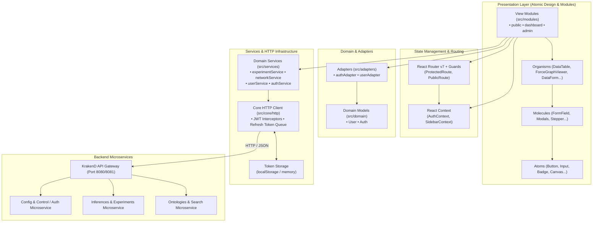

# Software Architecture Specification — BioPatternSG UI

> **Architecture Reference Document**  
> **Project:** `biopatternsg-ui`  
> **Location:** `.agents/architecture.md`  
> **Development Methodology:** Spec-Driven Development (SDD) with SpecKit  
> **Design System:** *The Clinical Lens* (Atomic Design)

---

## 1. Introduction & System Purpose

**BioPatternSG UI** is the frontend application for the **BioPatternSG** biomedical platform, a distributed microservices ecosystem designed for computational biology, metabolic pathway analysis, biomedical ontology alignment, and biological relationship inference via Machine Learning / AI over massive knowledge graphs.

The primary objective of the interface is to provide a clean, responsive, and clinical user experience (*"The Clinical Lens"*) enabling researchers to:
- Visualize and interact with large-scale 2D and 3D biological knowledge networks (genes, proteins, diseases, chemical compounds, biological pathways).
- Configure, execute, and monitor multi-step experimental bioinformatics inference pipelines.
- Manage users, permissions via Role-Based Access Control (RBAC), and scientific ontology sources (PubMed, Reactome, UniProt, Gene Ontology).

---

## 2. Architectural Principles & Design Style

The architecture of `biopatternsg-ui` combines four proven architectural patterns:

1. **Clean Architecture / Hexagonal Architecture (Ports & Adapters):**
   - Strict separation across **Domain** (`domain/`), **Adapters** (`adapters/`), **Services** (`services/`), and **Core Infrastructure** (`core/`).
   - The domain is completely decoupled from UI frameworks and third-party libraries.
   - Adapters isolate backend microservice contracts (DTOs) from frontend UI components and form models.

2. **Atomic Design in the Presentation Layer:**
   - The component library in `src/components/` is organized into **Atoms** (15), **Molecules** (14), and **Organisms** (12).
   - Guarantees high reusability, visual predictability, and consistent clinical aesthetics.

3. **Modular Feature Slices (Vertical Slices):**
   - Screen views and feature pages reside in `src/modules/` grouped by business context (`public`, `dashboard`, `admin`), avoiding circular dependencies and promoting modular scalability.

4. **Spec-Driven Development (SDD):**
   - Native integration with SpecKit workflows (`.specify/`) and persistent technical documentation for autonomous agents and engineers (`.agents/`).

---

## 3. High-Level Architecture Diagram



---

## 4. Source Code Structure

The following overview details the responsibility of each folder under `src/`:

```
src/
├── adapters/          # Adapters translating API DTOs to/from UI domain models
├── assets/            # Static assets (institution logos, illustrations)
├── components/        # Atomic Design component library
│   ├── atoms/         # Indivisible primitives (Button, Input, Badge, Canvas...)
│   ├── molecules/     # Cohesive multi-atom functional units (FormField, Modals...)
│   └── organisms/     # Complex modular sections and widgets (ForceGraphViewer, DataTable...)
├── config/            # Static configuration, RBAC roles, and biological category styling
├── context/           # Global application state (AuthContext, SidebarContext)
├── core/              # Core frontend infrastructure
│   ├── http/          # HTTP client, JWT interceptors, and secure token persistence
│   └── router/        # Route guard components (ProtectedRoute, PublicRoute)
├── domain/            # Pure business entities and contracts (UI-agnostic)
│   └── models/        # Auth.ts, User.ts
├── lib/               # Utility libraries (Tailwind cn, clsx helpers)
├── modules/           # Screens and feature views organized by functional slice
│   ├── admin/         # User administration and role provisioning
│   ├── dashboard/     # Experiments, biological networks, and inference visualization
│   └── public/        # Landing page, authentication, registration, password recovery
├── routes/            # Centralized application route path definitions
├── services/          # Microservice API client wrappers and DTO schemas
│   └── models/        # Backend DTO contracts (Experiment.ts, Pathway.ts)
└── utils/             # Data transformation utilities (CSV parsers, graph data formatting)
```

---

## 5. Architectural Layers in Detail

### 5.1. Domain Layer (`src/domain/`)
Encapsulates pure business entities free of third-party framework or UI library dependencies:
- **`User.ts`**: Core user entity, roles (`admin`, `admin-user`, `researcher`), and profile state.
- **`Auth.ts`**: Session credentials, JWT token pairs (`accessToken`, `refreshToken`), and identity structures.

### 5.2. Adapters Layer (`src/adapters/`)
Implements the adapter design pattern to decouple frontend views from backend API schema changes:
- **`authAdapter.ts`**: Converts user form inputs into backend authentication payloads and maps API token responses into clean `TokenPair` domain models.
- **`userAdapter.ts`**: Maps API user representations into table-ready domain structures.

### 5.3. Core & HTTP Infrastructure Layer (`src/core/`)
Manages application-wide networking and security policies:
- **HTTP Client (`core/http/httpClient.ts`):** Typed wrapper over the native `fetch` API.
- **Request Interceptors (`requestInterceptors.ts`):** Automatically injects `Authorization: Bearer <token>` headers on every outgoing authenticated request.
- **Response Interceptors & Auto-Refresh (`responseInterceptors.ts`):**
  - Detects `401 Unauthorized` responses.
  - Implements a **concurrent request queue** preventing thundering herd refresh storms when multiple requests fail simultaneously.
  - Executes token refresh via the `refreshToken`. If renewal fails, emits the global `SESSION_EXPIRED_EVENT` triggering immediate logout and navigation to login.
- **Token Persistence (`tokenStorage.ts`):** Secure abstraction over browser `localStorage` providing safe token getters, setters, and revocation (`clearTokens`).

### 5.4. Routing & RBAC Security Layer (`src/core/router/` and `src/config/roles.ts`)
Built upon React Router DOM v7 with declarative route guards:
- **`ProtectedRoute.tsx`:** Verifies authenticated sessions. Unauthenticated users are redirected to the landing page (`/`). Evaluates role permissions via `isRouteAllowedForRole()`.
- **`PublicRoute.tsx`:** Prevents authenticated users from accessing public-only routes (e.g. login), redirecting them directly to `/dashboard/experiments`.
- **Supported RBAC Roles:**
  - `admin`: Full system control and user administration.
  - `admin-user`: Operational user and researcher provisioning.
  - `researcher`: Full access to experiments, knowledge graphs, and AI inferences.

### 5.5. Services Layer (`src/services/`)
Encapsulates microservice API endpoints:
- **`apiConfig.ts`**: Resolves base API URLs depending on the environment:
  - In **Development**: Uses relative URLs (`""`) delegating to Vite's reverse proxy (`vite.config.ts`), completely eliminating CORS preflight friction.
  - In **Production**: Connects directly to the KrakenD API Gateway endpoint configured in `VITE_API_URL`.
- **Domain Services:**
  - `authService.ts`: Login, token refresh, password recovery.
  - `experimentService.ts`: Full experiment lifecycle (creation, TransE/RotatE model configuration, pipeline monitoring, and pathway retrieval).
  - `networkService.ts`: Biological network graph queries and persistence.
  - `userService.ts`: User management and role assignment.

### 5.6. Presentation Layer (Atomic Design)
Documented in [`.agents/components/`](file:///home/yacson/Proyectos/biopatternsg-ms/services/biopatternsg-ui/.agents/components/README.md):
- **Atoms (15):** Basic building blocks (`Button`, `Input`, `Badge`, `LoadingSpinner`, `ForceGraphCanvas`).
- **Molecules (14):** Composed units with UI state (`FormField`, `NodeSearchSelect`, `NodeDetailPanel`, `Stepper`, modals).
- **Organisms (12):** Autonomous high-level structures:
  - `ForceGraphViewer`: Master biological network explorer supporting 2D Canvas, contrast profiles (`black`, `white`, `skyblue`), attribute inspection, and search.
  - `DataTable`: Generic data grid with column sorting, server-side pagination, and custom cell renders.
  - `DataForm`: Dynamic form generator driven by `React Hook Form` and `Zod` validation schemas.
  - `DashboardLayout`: Master shell orchestrating `Sidebar`, `TopBar`, and `<Outlet />`.

### 5.7. Feature Modules Layer (`src/modules/`)
Organized by vertical slice:
- **`public/`:** Landing page, embedded authentication (`HeroSection`), user registration, and password recovery.
- **`dashboard/experiments/`:** Central researcher workspace:
  - 4-step guided experiment creation wizard (`StepGeneralConfig`, `StepModelParameters`, `StepExpertObjects`, `StepSearchConfig`).
  - Real-time pipeline monitoring (`PipelineStatus`).
  - Biological pathway exploration (`PathwayListView`, `PathwayDetailModal`).
- **`dashboard/networks/`:** Dedicated workspace for biological graph exploration.
- **`admin/users/`:** User management and access control.

---

## 6. Form Handling & Type-Safe Validation

Forms use a declarative pattern powered by `DataForm` and `DataFormConfig`:

```typescript
// Define schema with Zod (type-safe)
const experimentSchema = z.object({
  title: z.string().min(3),
  modelType: z.enum(["transE", "rotate", "complex"]),
  threshold: z.number().min(0).max(1)
});

// Pass config to DataForm organism
<DataForm
  config={{
    schema: experimentSchema,
    fields: [
      { name: "title", label: "Title", type: "text", required: true },
      { name: "modelType", label: "Model", type: "select", options: [...] }
    ],
    onSubmit: async (data) => { ... }
  }}
/>
```

Benefits:
- Instant client-side validation with accessible inline error messages.
- End-to-end type safety without duplicate TypeScript interface maintenance.
- Elimination of repetitive boilerplate code.

---

## 7. Biological Network Visualization Engine

Graph visualization is a core capability of BioPatternSG:

1. **Dual-Engine Rendering:**
   - **HTML5 2D Canvas (`ForceGraphCanvas`):** Accelerated canvas rendering optimized for thousands of nodes and edges without frame drops, featuring continuous physical force simulation (`requestAnimationFrame`), zoom, and pan.
   - **Optional 3D Engine (`react-force-graph-3d` / Three.js):** For spatial molecular subgraph analysis.
2. **Clinical Contrast Profiles (`forceGraphProfiles.ts`):**
   - **Black Profile:** High-contrast dark background for fluorescent biological entity highlighting.
   - **White Profile:** Clean light background optimized for scientific paper publication figures.
   - **Skyblue Profile:** Calibrated blue tone reducing eye strain during long-duration research.
3. **Biological Category Semantic Mapping:**
   - Standardized colors assigned per entity category (`PROTEIN`, `GENE`, `PATHWAY`, `CHEMICAL`, `DISEASE`).

---

## 8. Infrastructure, Environments & Deployment

### 8.1. Environment Strategy & Local Reverse Proxy
To bypass CORS restrictions during development:
- `vite.config.ts` runs a local dev proxy forwarding API requests to `http://localhost:8081`.
- In production, the client connects directly to the KrakenD API Gateway endpoint specified in `VITE_API_URL`.

### 8.2. Containerization with Docker & Nginx
The project includes an optimized `Dockerfile`:
- **CI/CD Mode (Default for Jenkins):** Lightweight `nginx:alpine` image copying pre-built static assets from `dist/` and serving them on port 80.
- **Nginx Configuration (`nginx.conf`):**
  - Implements `try_files $uri $uri/ /index.html;` to support HTML5 History API routing in Single Page Applications (SPA) without 404 errors on deep route reloads.

---

## 9. Technology Stack Summary

| Dimension | Technology | Role |
| :--- | :--- | :--- |
| **UI Library** | React 19.2 + TypeScript 6 | Component rendering and static typing |
| **Bundler & Dev Server** | Vite 8 | Fast compilation, HMR, and local reverse proxy |
| **Routing** | React Router DOM v7 | Nested layouts, route matching, and RBAC guards |
| **Styling & Design System** | Tailwind CSS 3.4 + CVA | *The Clinical Lens* semantic tokens |
| **Form Management** | React Hook Form 7 + Zod 4 | Declarative forms with strict schema validation |
| **Graph Visualization** | HTML5 Canvas 2D + Three.js | High-density biological network rendering |
| **Iconography** | Lucide React | Semantically consistent clinical icons |
| **Web Server / Production** | Nginx Alpine | High-efficiency SPA web server in Docker |
| **Methodology** | Spec-Driven Development (SDD) | Specification-guided development via SpecKit |
