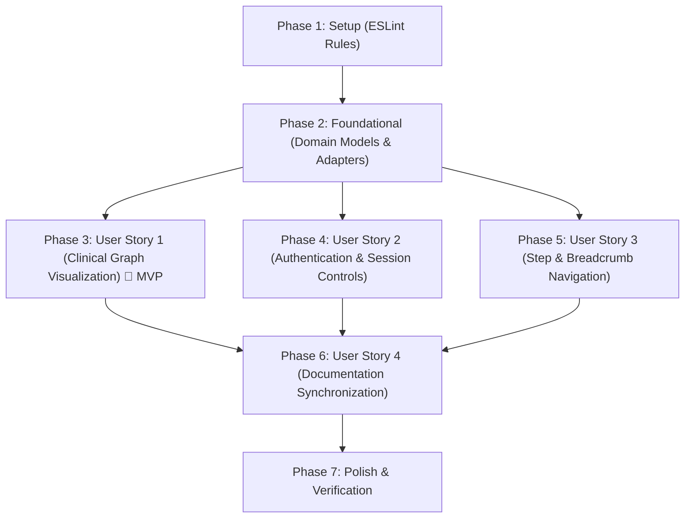

# Tasks: Atomic Design Hierarchy Decoupling

**Input**: Design documents from `specs/001-atomic-hierarchy-decoupling/`  
**Prerequisites**: `plan.md`, `spec.md`, `research.md`, `data-model.md`, `contracts/`, `quickstart.md`  
**Branch**: `feature/01-atomic-design-hierarchy-decoupling`  

## Format: `[ID] [P?] [Story] Description`

- **[P]**: Can run in parallel (different files, no dependencies)
- **[Story]**: Which user story this task belongs to (`[US1]`, `[US2]`, `[US3]`, `[US4]`)
- Include exact file paths in descriptions

---

## Phase 1: Setup (Shared Infrastructure)

**Purpose**: Configure automated architectural boundary enforcement and establish baseline quality gates.

- [x] T001 Configure ESLint boundary enforcement rules (`no-restricted-imports`) in `eslint.config.js` for atoms, molecules, organisms, and domain layers per `specs/001-atomic-hierarchy-decoupling/contracts/lint-boundary-contract.md`
- [x] T002 [P] Run baseline build check via `npm run build` and baseline lint check via `npm run lint` in repository root

---

## Phase 2: Foundational (Blocking Prerequisites)

**Purpose**: Create shared domain entities, visual contrast profiles, and DTO adapters required by all subsequent component decoupling tasks.

**⚠️ CRITICAL**: Must complete before user story component refactoring can begin.

- [x] T003 [P] Create biological graph domain entities (`GraphNodeInput`, `GraphLinkInput`, `GraphNode`, `GraphLink`, `ForceGraphData`) in `src/domain/models/Graph.ts` per `specs/001-atomic-hierarchy-decoupling/data-model.md`
- [x] T004 [P] Create clinical visual contrast profiles (`GraphBackground = 'black' | 'white' | 'skyblue'`, `GraphVisualProfile`, `GRAPH_PROFILES`, `getGraphProfile`) in `src/config/forceGraphProfiles.ts` per `specs/001-atomic-hierarchy-decoupling/data-model.md`
- [x] T005 [P] Create pathway domain model (`GroupedPathway`, `PathwayDetailModalProps`) in `src/domain/models/Pathway.ts` per `specs/001-atomic-hierarchy-decoupling/data-model.md`
- [x] T006 [P] Create experiment & pipeline domain models (`PipelineStage = 'queued' | 'running' | 'completed' | 'failed'`, `PipelineStatus`, `BiologicalRoleItem`) in `src/domain/models/Experiment.ts` per `specs/001-atomic-hierarchy-decoupling/data-model.md`
- [x] T007 [P] Implement pathway adapter functions (`toGroupedPathway`, `toGroupedPathwayList`) in `src/adapters/pathwayAdapter.ts` per `specs/001-atomic-hierarchy-decoupling/contracts/component-contracts.md`
- [x] T008 [P] Implement experiment adapter functions (`toBiologicalRoleList`, `toPipelineStatus`) in `src/adapters/experimentAdapter.ts` per `specs/001-atomic-hierarchy-decoupling/contracts/component-contracts.md`

**Checkpoint**: Foundation ready - all shared domain models and adapters created. User story implementation can now proceed.

---

## Phase 3: User Story 1 - Seamless & High-Performance Clinical Graph Visualization (Priority: P1) 🎯 MVP

**Goal**: Decouple graph visualizers, modals, and detail panels from inverted organism dependencies and service DTOs.

**Independent Test**: Load sample network graph, toggle contrast modes (Dark, Light, Sky Blue), inspect biological roles with `useBiologicalRoles`, and open node details with zero console errors.

- [x] T009 [P] [US1] Refactor `src/components/atoms/ForceGraphCanvas.tsx` to import types and profiles exclusively from `@/domain/models/Graph` and `@/config/forceGraphProfiles`
- [x] T010 [P] [US1] Implement custom hook `useBiologicalRoles` in `src/modules/dashboard/experiments/hooks/useBiologicalRoles.ts` managing async fetching from `experimentService` with `rolesData`, `isLoading`, and `error` state
- [x] T011 [US1] Refactor `src/components/molecules/BiologicalRolesModal.tsx` to accept presentational props (`rolesData: BiologicalRoleItem[]`, `isLoading: boolean`, `error?: string | null`, `onClose: () => void`, `onRetry?: () => void`) without importing `experimentService` or DTOs
- [x] T012 [P] [US1] Refactor `src/components/molecules/GraphDataUploadModal.tsx` to import graph types from `@/domain/models/Graph` instead of organisms
- [x] T013 [P] [US1] Refactor `src/components/molecules/NodeDetailPanel.tsx` to import node and link models from `@/domain/models/Graph`
- [x] T014 [P] [US1] Refactor `src/components/molecules/NodeSearchSelect.tsx` to import node models from `@/domain/models/Graph`
- [x] T015 [P] [US1] Refactor `src/components/molecules/PathwayDetailModal.tsx` to consume domain model `GroupedPathway` from `@/domain/models/Pathway` instead of service DTOs
- [x] T016 [P] [US1] Refactor `src/components/molecules/PipelineStatus.tsx` to consume domain model `PipelineStatus` from `@/domain/models/Experiment` instead of service DTOs
- [x] T017 [US1] Update `src/components/organisms/forceGraph/ForceGraphViewer.tsx` to import graph models and profiles from `@/domain/models/Graph` and `@/config/forceGraphProfiles`
- [x] T018 [US1] Delete legacy export files `src/components/organisms/forceGraph/forceGraphTypes.ts` and `src/components/organisms/forceGraph/forceGraphProfiles.ts`
- [x] T019 [US1] Integrate `useBiologicalRoles` into `src/modules/dashboard/experiments/PathwayGraphView.tsx` to supply presentational props to `BiologicalRolesModal`

**Checkpoint**: User Story 1 complete - clinical graph canvas, modals, and panels decoupled with zero inverted dependencies.

---

## Phase 4: User Story 2 - Decoupled User Authentication & Session Controls (Priority: P2)

**Goal**: Decouple landing hero section and user menu from concrete backend services and global auth contexts.

**Independent Test**: Verify `HeroSection` delegates login credentials via callback to `Landing.tsx`, and `UserMenu` renders user info and triggers logout via props from `TopBar`.

- [x] T020 [P] [US2] Refactor `src/components/molecules/UserMenu.tsx` to accept `user?: UserProfileDisplay | null` and `onLogout?: () => void` via props without importing `AuthContext`
- [x] T021 [US2] Update `src/components/organisms/TopBar.tsx` to retrieve user session and logout handler from `useAuth()` and pass them as props to `UserMenu`
- [x] T022 [P] [US2] Refactor `src/components/organisms/HeroSection.tsx` to accept `onLoginSubmit: (values: LoginFormValues) => Promise<void>`, `isLoading?: boolean`, and `onForgotPassword?: () => void` props without importing `authService` or `authAdapter`
- [x] T023 [US2] Update `src/modules/public/Landing.tsx` to orchestrate `authService.loginUser()` and `authAdapter.toLoginPayload()`, supplying the `onLoginSubmit` callback to `HeroSection`

**Checkpoint**: User Story 2 complete - authentication and user session navigation decoupled from presentational components.

---

## Phase 5: User Story 3 - Predictable Step & Breadcrumb Navigation (Priority: P3)

**Goal**: Promote `Breadcrumb` to a pure molecule and decouple step navigation from direct router bindings.

**Independent Test**: Verify breadcrumbs and step header render correctly across views and dispatch navigation callbacks without direct router imports.

- [x] T024 [US3] Create `src/components/molecules/Breadcrumb.tsx` composing `Button` atom and Lucide icons with `onNavigate?: (href: string) => void` callback prop per `specs/001-atomic-hierarchy-decoupling/data-model.md`
- [x] T025 [US3] Delete obsolete atom `src/components/atoms/Breadcrumb.tsx`
- [x] T026 [US3] Refactor `src/components/molecules/ManualStepHeader.tsx` to accept `onBack?: () => void` and `onNavigate?: (href: string) => void` without importing `react-router-dom`, importing `Breadcrumb` from `@/components/molecules/Breadcrumb`
- [x] T027 [P] [US3] Update breadcrumb imports and navigation callbacks in admin module `src/modules/admin/users/CreateUser.tsx`
- [x] T028 [P] [US3] Update breadcrumb imports and navigation callbacks in experiment modules `src/modules/dashboard/experiments/ConfigureInferences.tsx`, `CreateExperiment.tsx`, `ExperimentExecution.tsx`, `Experiments.tsx`, and `PathwayGraphView.tsx`
- [x] T029 [P] [US3] Update breadcrumb imports in network modules `src/modules/dashboard/networks/CreateNetwork.tsx` and public `src/modules/public/Landing.tsx`

**Checkpoint**: User Story 3 complete - breadcrumbs and headers promoted to pure presentational molecules with decoupled callbacks.

---

## Phase 6: User Story 4 - Modular Component Composition for UI Authors (Priority: P4)

**Goal**: Verify repository-wide architectural purity and synchronize component catalog documentation per Constitution Principle II.

**Independent Test**: Run `npm run lint` and `npm run build` with zero violations, and verify all modified components have synchronized documentation in `.agents/components/`.

- [x] T030 [P] [US4] Relocate and update component documentation for `Breadcrumb` in `.agents/components/molecules/Breadcrumb.md` (removing `.agents/components/atoms/Breadcrumb.md`) and update catalog index in `.agents/components/README.md`
- [x] T031 [P] [US4] Update component documentation for `ForceGraphCanvas` in `.agents/components/atoms/ForceGraphCanvas.md` reflecting imports from `@/domain/models/Graph` and `@/config/forceGraphProfiles`
- [x] T032 [P] [US4] Update component documentation for `BiologicalRolesModal`, `GraphDataUploadModal`, `NodeDetailPanel`, and `NodeSearchSelect` in `.agents/components/molecules/` reflecting updated prop signatures and domain imports
- [x] T033 [P] [US4] Update component documentation for `PathwayDetailModal`, `PipelineStatus`, `ManualStepHeader`, and `UserMenu` in `.agents/components/molecules/` reflecting decoupled prop interfaces
- [x] T034 [P] [US4] Update component documentation for `HeroSection` and `TopBar` in `.agents/components/organisms/` reflecting prop-driven form handlers and top-level user props

**Checkpoint**: User Story 4 complete - all component specifications and catalogs synchronized with implementation.

---

## Phase 7: Polish & Cross-Cutting Concerns

**Purpose**: Execute final automated quality checks, regression verification, and cleanups across all stories.

- [x] T035 Run automated dependency boundary grep checks from `specs/001-atomic-hierarchy-decoupling/quickstart.md` ensuring zero prohibited imports remain
- [x] T036 Execute strict TypeScript build check via `npm run build` and ESLint boundary check via `npm run lint`
- [x] T037 Perform end-to-end regression validation following manual scenarios in `specs/001-atomic-hierarchy-decoupling/quickstart.md`

---

## Dependencies & Execution Order

### Phase Dependencies

- **Setup (Phase 1)**: Can start immediately.
- **Foundational (Phase 2)**: Depends on Phase 1 - BLOCKS all user story refactoring.
- **User Stories (Phase 3, 4, 5)**: Depend on Phase 2. Can be executed sequentially or in parallel by separate developers.
- **Documentation (Phase 6)**: Depends on completion of User Stories 1, 2, and 3.
- **Polish (Phase 7)**: Final gate after all stories and documentation are complete.

### Parallel Opportunities

- **Phase 2**: T003, T004, T005, T006, T007, T008 can all execute in parallel across different files.
- **Phase 3 (US1)**: T009, T010, T012, T013, T014, T015, T016 can execute in parallel once Phase 2 completes.
- **Phase 4 (US2)**: T020 and T022 can execute in parallel.
- **Phase 5 (US3)**: T027, T028, and T029 can execute in parallel across consuming modules once T024-T026 complete.
- **Phase 6 (US4)**: T030, T031, T032, T033, T034 can all execute in parallel.

---

## Implementation Strategy

### MVP First (User Story 1 Only)

1. Complete Phase 1: Setup (T001-T002)
2. Complete Phase 2: Foundational (T003-T008)
3. Complete Phase 3: User Story 1 (T009-T019)
4. **STOP and VALIDATE**: Verify graph viewer, contrast themes, and biological roles modal via `npm run build` and `quickstart.md` Scenario 1 & 2.

### Incremental Delivery

1. Foundation ready (Phase 1 + 2)
2. Add User Story 1 (MVP: Clinical graph decoupling) → Validate
3. Add User Story 2 (Authentication & UserMenu decoupling) → Validate
4. Add User Story 3 (Breadcrumb molecule promotion & navigation) → Validate
5. Add User Story 4 (Documentation synchronization) → Validate
6. Final verification & quality gate (Phase 7)
