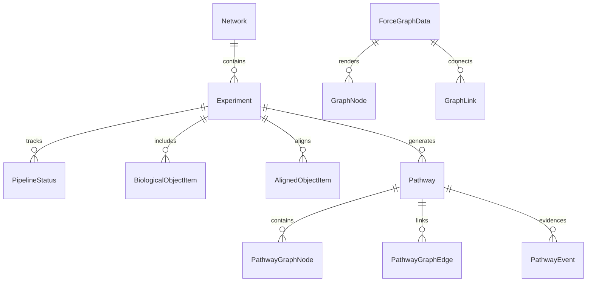

# Data Model: Pure Domain Models Consolidation

**Feature**: `specs/002-domain-models-consolidation`  
**Date**: 2026-11-18  
**Status**: Completed

---

## 1. Domain Entities (`src/domain/models/`)

### 1.1 Common Domain Primitives (`src/domain/models/Common.ts`)

Shared generic structures and biological primitives across all domain entities:

```typescript
export interface PaginatedResult<T> {
  count: number;
  list: T[];
  page?: number;
  size?: number;
  totalPages?: number;
}

export type BiologicalIdentifier = string;
```

### 1.2 Biological Network (`src/domain/models/Network.ts`)

Pure biological network model representing user-created biological graph topologies:

```typescript
export interface Network {
  id: string;
  userId: string;
  name: string;
  description: string;
  createdAt: string; // ISO 8601 string normalized by adapter
  updatedAt?: string;
  nodesCount?: number;
  edgesCount?: number;
}

export interface CreateNetworkInput {
  name: string;
  description: string;
}
```

### 1.3 Experiment & Pipeline Entities (`src/domain/models/Experiment.ts`)

Pure domain representations for experiments, execution status, biological objects, and step definitions:

```typescript
export type PipelineStage = "queued" | "running" | "completed" | "failed";

export interface PipelineStatus {
  step: string;
  status: string;
  createdAt?: string; // ISO 8601 string
  progressPercentage?: number;
}

export interface BiologicalRoleItem {
  id?: string;
  symbol: string;
  roles: string[];
  activeRoles?: string[];
  category?: string;
  score?: number;
  description?: string;
}

export interface InferenceRolesDomain {
  pipelineId: string;
  restrictionLevel: string;
  roles: Record<string, string[]>;
  allSymbols: string[];
  entitiesWithActiveRolesCount: number;
}

export interface BiologicalObjectItem {
  id?: string;
  name: string;
  symbol?: string;
  synonyms?: string[];
  biotypes: string[];
  meshRoles: string[];
  roles: string[];
  alternativeIds?: string[];
  description?: string;
}

export type AlignedStatus = "ALIGNED" | "ALIGNED_AS" | "NO_ALIGNED" | "NEW" | "MODIFIED" | "CUSTOM_SYNONYMS";

export interface AlignedObjectItem {
  id: string;
  symbol: string;
  status: AlignedStatus;
  synonyms: string[];
}

export interface TranscriptionFactorConfig {
  sources: string[];
  genome?: string;
  track?: string;
  identity?: number;
  chromosome?: string;
  strand?: string;
  start?: string;
  end?: string;
  reliability: number;
  promoterRegion: string;
}

export interface ExpertObject {
  symbol: string | null;
  uniprotId: string | null;
  hgncId: string | null;
}

export interface ExperimentMetric {
  label: string;
  value: string;
  subLabel?: string;
  subLabelColor?: "green" | "red" | "blue" | "default";
  progress?: number;
  hasWarnings?: boolean;
  warningCount?: number;
}

export interface SubStep {
  name: string;
  status: "COMPLETED" | "ACTIVE" | "PENDING";
}

export interface PipelineStepExecution {
  id: string;
  name: string;
  status: "COMPLETED" | "ACTIVE" | "PENDING" | "FAILED";
  startTime?: string;
  duration?: string;
  outputText?: string;
  description: string;
  iconName: string;
  isManual?: boolean;
  actionRoute?: string;
  subSteps?: SubStep[];
  metrics?: ExperimentMetric[] | Record<string, string>;
}

export interface ExperimentExecution {
  experimentId: string;
  experimentName: string;
  networkId?: string;
  status: "ACTIVE" | "COMPLETED" | "FAILED" | "PENDING";
  totalExecutionTime: string;
  currentPhaseDuration: string;
  steps: PipelineStepExecution[];
}

export interface Experiment {
  id: string;
  name: string;
  description: string;
  networkId: string;
  levels?: number;
  retMax?: number;
  maxComplexes?: number;
  step?: string;
  transcriptionFactorConfig?: TranscriptionFactorConfig;
  expertObjects?: ExpertObject[];
  createdAt?: string; // ISO 8601 string
  status?: PipelineStatus;
  useOnlyPrincipalName?: boolean;
}

export type RestrictionLevel = "RESTRICTED" | "VERY_RESTRICTED" | "UNRESTRICTED";

export interface ManualStepMetadata {
  routeSegment: string;
  buttonLabel: string;
  iconName: string; // decoupled from LucideIcon
}
```

### 1.4 Pathway Entities (`src/domain/models/Pathway.ts`)

Pure pathway models and knowledge base relationship structures:

```typescript
export interface PathwayGraphNode {
  name: string;
  role?: string;
  type?: string;
}

export interface PathwayGraphEdge {
  first: string;
  relation: string;
  second: string;
  pubmedCount?: number;
}

export interface PathwayEvent {
  first: string;
  relation: string;
  second: string;
  pubmedIds: string[];
}

export interface Pathway {
  id: string;
  name: string;
  score?: number;
  length?: number;
  nodes?: PathwayGraphNode[];
  edges?: PathwayGraphEdge[];
  events?: PathwayEvent[];
  isExpanded?: boolean;
}

export interface GroupedPathway {
  key: string;
  name: string;
  pathways: Pathway[];
  totalScore?: number;
}
```

### 1.5 Graph Entities (`src/domain/models/Graph.ts`)

Existing pure graph models (established in feature 001):
- `GraphNodeInput`, `GraphLinkInput`
- `GraphNode`, `GraphLink`
- `ForceGraphData`
- `GraphDatasetUploadPayload`

### 1.6 Authentication & User Entities (`src/domain/models/Auth.ts`, `User.ts`)

Existing pure models:
- `AuthCredentials`, `AuthTokenResult`, `DecodedToken`
- `User`, `UserProfile`

---

## 2. Service DTO Models (`src/services/models/`)

Backend transport representations with `Dto` suffix:

### 2.1 Network DTO (`src/services/models/NetworkDto.ts` or `src/services/networkService.ts`)

```typescript
export interface NetworkDto {
  id: string;
  userId: string;
  name: string;
  description: string;
  createdAt: number; // Unix epoch milliseconds from backend
}

export interface PaginatedResponseDto<T> {
  count: number;
  list: T[];
}
```

### 2.2 Experiment DTOs (`src/services/models/Experiment.ts` -> renamed interfaces)

```typescript
export interface ExperimentDto {
  id: string;
  name: string;
  description: string;
  networkId: string;
  levels?: number;
  retMax?: number;
  maxComplexes?: number;
  step?: string;
  transcriptionFactorConfig?: TranscriptionFactorConfigDto;
  expertObjects?: ExpertObjectDto[];
  createdAt?: number; // Unix timestamp
  status?: PipelineStatusDto;
  useOnlyPrincipalName?: boolean;
}

export interface BiologicalObjectItemDto {
  symbol?: string;
  name: string;
  synonyms?: string[];
  biotypes: string[];
  meshRoles: string[];
  roles: string[];
  alternativeIds?: string[];
  description?: string;
}

export interface AlignedResultResponseDto {
  pipelineId: string;
  aligned: string[];
  noAligned: string[];
  alignedAs: AlignedAsItemDto[];
}
```

### 2.3 Pathway DTOs (`src/services/models/Pathway.ts`)

```typescript
export interface PathwayInferenceRequestDto {
  pipelineId: string;
  user?: string;
  restrictedObjects?: string[];
  closingObjects?: string[];
  summarizeKb?: boolean;
  maxDepth?: number;
}

export interface PathwayInferenceResponseDto {
  status: "SUCCESS" | "ERROR";
  pipelineId: string;
  pathwaysCount: number;
  executionTimeMs: number;
  graphNodesCount: number;
  graphEdgesCount: number;
  message?: string;
}
```

---

## 3. UI View Contracts (Localized in Modules)

UI presentation wrappers that compose or extend pure domain entities:

### 3.1 `UpdateBiologicalObjects.tsx`

```typescript
import type { BiologicalObjectItem } from "@/domain/models/Experiment";

export interface EditableBiologicalObject extends BiologicalObjectItem {
  id: string;
  isModified: boolean;
}
```

### 3.2 `ExperimentExecution.tsx`

```typescript
import type { ManualStepMetadata, ExperimentMetric } from "@/domain/models/Experiment";
import type { LucideIcon } from "lucide-react";

export interface ManualStepPresentation extends ManualStepMetadata {
  buttonIcon: LucideIcon;
}

export interface ParsedMetricItem extends ExperimentMetric {
  isLongText?: boolean;
}

export type RawMetricInput = ExperimentMetric[] | Record<string, string | number | boolean | null | undefined>;
```

---

## 4. Entity Relationship Diagram


