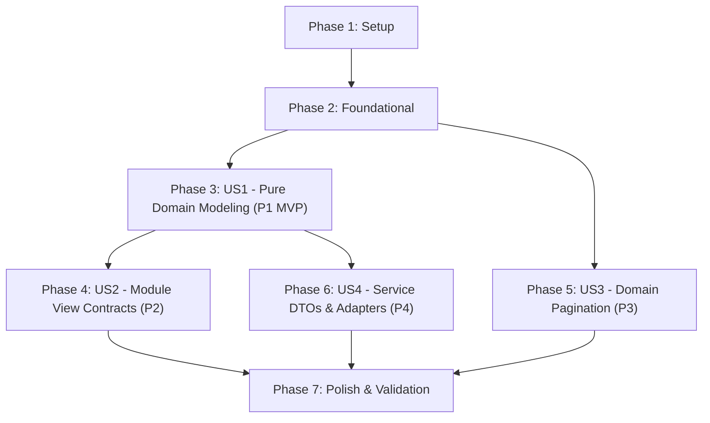

# Tasks: Pure Domain Models Consolidation

**Input**: Design documents from `/specs/002-domain-models-consolidation/`  
**Prerequisites**: [plan.md](./plan.md) (required), [spec.md](./spec.md) (required), [research.md](./research.md), [data-model.md](./data-model.md), [contracts/](./contracts/)  
**Organization**: Tasks are grouped by user story to enable independent implementation and testing of each story.

## Format: `[ID] [P?] [Story] Description`

- **[P]**: Can run in parallel (different files, no dependencies)
- **[Story]**: Which user story this task belongs to (e.g., US1, US2, US3, US4)
- Exact file paths included in all task descriptions

---

## Phase 1: Setup (Shared Infrastructure)

**Purpose**: Baseline verification and initial domain model infrastructure setup.

- [x] T001 Verify baseline repository status, build (`npm run build`), and linting (`npm run lint`) in `services/biopatternsg-ui`
- [x] T002 [P] Create initial common domain model file in `src/domain/models/Common.ts`
- [x] T003 [P] Create initial network domain model file in `src/domain/models/Network.ts`

---

## Phase 2: Foundational (Blocking Prerequisites)

**Purpose**: Core primitives and base types that MUST be established before story refactoring begins.

**⚠️ CRITICAL**: All user story phases depend on these base domain models and adapter foundations.

- [x] T004 Implement `PaginatedResult<T>` and `BiologicalIdentifier` primitives in `src/domain/models/Common.ts`
- [x] T005 [P] Implement pure `Network` entity (with normalized `createdAt: string`) and `CreateNetworkInput` in `src/domain/models/Network.ts`
- [x] T006 [P] Create `NetworkDto` and `PaginatedResponseDto<T>` wire contracts in `src/services/models/NetworkDto.ts`
- [x] T007 Create `networkAdapter` in `src/adapters/networkAdapter.ts` implementing `toDomain(dto: NetworkDto): Network` and `toPaginatedDomain(dto: PaginatedResponseDto<NetworkDto>): PaginatedResult<Network>`

**Checkpoint**: Base domain models and pagination primitives ready - user story implementation can begin.

---

## Phase 3: User Story 1 - Centralized & Type-Safe Biological Domain Modeling (Priority: P1) 🎯 MVP

**Goal**: Centralize and purify core domain models (`Experiment.ts`, `Pathway.ts`, `Graph.ts`) under `src/domain/models/` with zero UI framework or layer dependencies.

**Independent Test**: Verify that all domain models in `src/domain/models/` compile cleanly and contain zero imports from `react`, `lucide-react`, `src/components/`, `src/modules/`, `src/services/`, or `src/adapters/`.

### Implementation for User Story 1

- [x] T008 [P] [US1] Expand pure domain models in `src/domain/models/Experiment.ts` with `PipelineStatus`, `BiologicalObjectItem`, `AlignedStatus`, `AlignedObjectItem`, `TranscriptionFactorConfig`, `ExpertObject`, `ExperimentMetric`, `SubStep`, `PipelineStepExecution`, `ExperimentExecution`, `Experiment`, and `ManualStepMetadata`
- [x] T009 [P] [US1] Expand pure domain models in `src/domain/models/Pathway.ts` with `PathwayGraphNode`, `PathwayGraphEdge`, `PathwayEvent`, `Pathway`, and `GroupedPathway`
- [x] T010 [P] [US1] Audit and enforce purity in `src/domain/models/Graph.ts`, confirming `GraphNode`, `GraphLink`, `ForceGraphData`, and upload payloads have zero framework couplings
- [x] T011 [US1] Audit `src/domain/models/Auth.ts` and `src/domain/models/User.ts` for constitutional purity (Principle III)
- [x] T012 [US1] Execute domain purity grep validation ensuring zero imports from `react`, `lucide-react`, or application layers across `src/domain/models/`

**Checkpoint**: At this point, User Story 1 is fully functional as an MVP foundation: all business domain models are declared in `src/domain/models/` with zero framework contamination.

---

## Phase 4: User Story 2 - Resilient Biological Object Editing & Pipeline Step Navigation (Priority: P2)

**Goal**: Eliminate inline business interfaces from experiment module views by importing from domain models and using localized view contracts for transient UI state.

**Independent Test**: Navigate to experiment editing and execution views (`UpdateAlignedObjects`, `UpdateBiologicalObjects`, `ExperimentExecution`); verify that object filtering, modification tracking, and manual steps render and operate without inline entity declarations.

### Implementation for User Story 2

- [x] T013 [P] [US2] Refactor `src/modules/dashboard/experiments/UpdateAlignedObjects.tsx`: remove inline `interface AlignedObjectItem` and import `AlignedObjectItem` and `AlignedStatus` from `@/domain/models/Experiment`
- [x] T014 [P] [US2] Refactor `src/modules/dashboard/experiments/UpdateBiologicalObjects.tsx`: remove inline `interface EditableBiologicalObject`, import `BiologicalObjectItem` and `RestrictionLevel` from `@/domain/models/Experiment`, and declare localized `EditableBiologicalObject extends BiologicalObjectItem` view contract with `isModified: boolean`
- [x] T015 [US2] Refactor `src/modules/dashboard/experiments/ExperimentExecution.tsx`: replace inline `interface ManualStepDefinition` with localized `ManualStepPresentation extends ManualStepMetadata` composing `iconName` with `LucideIcon`
- [x] T016 [US2] Refactor `src/modules/dashboard/experiments/ExperimentExecution.tsx`: replace inline `interface ParsedMetricItem` and `type RawMetricInput` with types extending `ExperimentMetric` imported from `@/domain/models/Experiment`
- [x] T017 [US2] Verify that experiment management screens compile with zero TypeScript errors following inline type removal

**Checkpoint**: User Stories 1 AND 2 are complete: modules consume pure domain models and manage presentation concerns via clean view contracts.

---

## Phase 5: User Story 3 - Unified Domain Pagination & Knowledge Base Collections (Priority: P3)

**Goal**: Standardize pagination mechanics and remove inline domain entity declarations from service implementation files.

**Independent Test**: Fetch paginated networks through `networkService.getNetworks()`; verify that returned data conforms to `PaginatedResult<Network>` with normalized ISO 8601 timestamps.

### Implementation for User Story 3

- [x] T018 [US3] Refactor `src/services/networkService.ts`: remove inline `interface Network` and `interface PaginatedResponse<T>`, importing `NetworkDto` and `PaginatedResponseDto` from `@/services/models/NetworkDto`
- [x] T019 [US3] Update `networkService.getNetworks()` in `src/services/networkService.ts` to return `Promise<PaginatedResult<Network>>` transformed via `networkAdapter.toPaginatedDomain`
- [x] T020 [US3] Update network consumer modules (e.g. `src/modules/dashboard/networks/Networks.tsx` or related views) to consume `Network` and `PaginatedResult<Network>` from `@/domain/models/`
- [x] T021 [US3] Verify network listing and pagination functionality compiles and operates without inline service models

**Checkpoint**: User Stories 1, 2, and 3 are complete: services use standardized domain pagination and wire DTOs.

---

## Phase 6: User Story 4 - Strict Service Boundary & DTO Decoupling (Priority: P4)

**Goal**: Clearly distinguish backend wire DTOs from domain models in `src/services/models/` using the `Dto` suffix, and mediate all transformations via adapters.

**Independent Test**: Verify that all interfaces in `src/services/models/` carry the `Dto` suffix and that UI modules consume only domain entities mediated by `src/adapters/`.

### Implementation for User Story 4

- [x] T022 [P] [US4] Refactor `src/services/models/Experiment.ts`: rename backend wire transport interfaces with `Dto` suffix (`ExperimentDto`, `PipelineStatusDto`, `BiologicalObjectItemDto`, `AlignedResultResponseDto`, `InferenceResponseDto`)
- [x] T023 [P] [US4] Refactor `src/services/models/Pathway.ts`: rename backend wire transport interfaces with `Dto` suffix (`PathwayDto`, `PathwayGraphNodeDto`, `PathwayGraphEdgeDto`, `PathwayInferenceResponseDto`)
- [x] T024 [US4] Update `src/adapters/experimentAdapter.ts` to map `ExperimentDto`, `BiologicalObjectItemDto`, and `AlignedResultResponseDto` into domain `Experiment` entities
- [x] T025 [US4] Update `src/adapters/pathwayAdapter.ts` to map `PathwayDto` and related DTOs into domain `Pathway` entities
- [x] T026 [US4] Update `src/services/experimentService.ts` and `src/services/pathwayService.ts` to type internal HTTP responses with DTOs and return domain models where consumed by modules
- [x] T027 [US4] Update module callers and components interacting with experiment and pathway services to ensure seamless boundary mediation

**Checkpoint**: All user stories (US1–US4) are fully implemented and architecturally decoupled.

---

## Phase 7: Polish & Cross-Cutting Concerns

**Purpose**: Repository-wide architectural validation, linting, build verification, and documentation synchronization.

- [x] T028 [P] Run domain purity grep checks (`git grep -E "from ['\"](react|react-dom|lucide-react)" src/domain/models/`) and verify zero matches
- [x] T029 [P] Run inline business entity grep checks (`git grep "interface AlignedObjectItem" src/modules/`) and verify zero matches
- [x] T030 Run full ESLint boundary and style checks (`npm run lint`) and resolve any residual warnings
- [x] T031 Run strict TypeScript build (`npm run build`) and verify 0 compilation errors across the entire codebase
- [x] T032 Execute manual validation scenarios in `specs/002-domain-models-consolidation/quickstart.md`

---

## Dependencies & Execution Order

### Phase Dependencies

- **Setup (Phase 1)**: No dependencies - can start immediately
- **Foundational (Phase 2)**: Depends on Setup completion - BLOCKS all user stories
- **User Story 1 (Phase 3)**: Depends on Foundational phase - establishes pure domain models
- **User Story 2 (Phase 4)**: Depends on US1 (requires domain entities in `Experiment.ts`)
- **User Story 3 (Phase 5)**: Depends on Foundational (requires `Common.ts` and `Network.ts`)
- **User Story 4 (Phase 6)**: Depends on US1, US2, and US3 (refactors service DTOs and adapters)
- **Polish (Phase 7)**: Depends on completion of all user story phases

### User Story Dependencies

---

## Parallel Opportunities

- **Setup (Phase 1)**: T002 and T003 can run in parallel
- **Foundational (Phase 2)**: T005 and T006 can run in parallel
- **User Story 1 (Phase 3)**: T008, T009, and T010 can run in parallel
- **User Story 2 (Phase 4)**: T013 and T014 can run in parallel
- **User Story 4 (Phase 6)**: T022 and T023 can run in parallel
- **Polish (Phase 7)**: T028 and T029 can run in parallel

---

## Implementation Strategy

### MVP First (User Story 1 Only)
1. Complete Phase 1 (Setup) and Phase 2 (Foundational)
2. Complete Phase 3 (User Story 1: Pure Domain Models in `src/domain/models/`)
3. **STOP and VALIDATE**: Verify that domain models are 100% pure, compiling with zero dependencies on React or services.

### Incremental Delivery
1. Add User Story 2: Decouple module views (`UpdateAlignedObjects`, `UpdateBiologicalObjects`, `ExperimentExecution`) by importing domain entities.
2. Add User Story 3: Clean up `networkService.ts` and unify collection pagination.
3. Add User Story 4: Complete DTO suffixing and adapter mediation across `Experiment` and `Pathway`.
4. Run Phase 7 polish: Lint, build, and quickstart scenarios.
