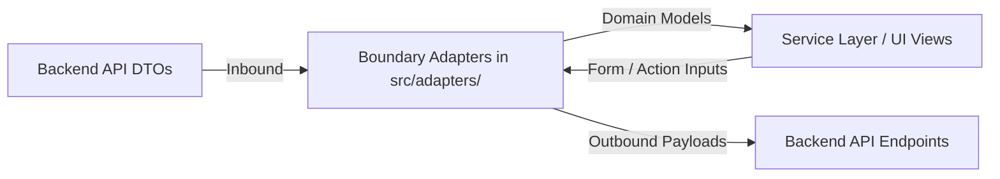

# Data Model & Boundary Signatures: Mandatory Adapter Pattern

## 1. Adapter Boundary Architecture

Adapters reside strictly in `src/adapters/` and provide bidirectional mediation:
- **Inbound (DTO -> Domain)**: Converts wire DTOs (`src/services/models/*`) into pure domain models (`src/domain/models/*`), normalizing timestamps into ISO 8601 strings.
- **Outbound (Domain/Form -> Payload)**: Converts internal form state or domain models into wire payloads expected by the KrakenD API Gateway and microservices.

---

## 2. Adapter Function Signatures

### 2.1. Network Adapter (`src/adapters/networkAdapter.ts`)

| Export Name | Direction | Input Type | Output Type | Responsibility |
|:---|:---:|:---|:---|:---|
| `toNetworkDomain` | Inbound | `NetworkDto` | `Network` | Converts epoch timestamp to ISO string and maps network fields |
| `toPaginatedNetworksDomain` | Inbound | `PaginatedResponseDto<NetworkDto>` | `PaginatedResult<Network>` | Maps paginated network collection |
| `toCreateNetworkPayload` | Outbound | `CreateNetworkInput` | `CreateNetworkPayload` | Sanitizes name/description for API POST |
| `networkAdapter` | Namespace | - | `NetworkAdapter` | Object containing all above functions |

---

### 2.2. Experiment Adapter (`src/adapters/experimentAdapter.ts`)

| Export Name | Direction | Input Type | Output Type | Responsibility |
|:---|:---:|:---|:---|:---|
| `toPipelineStatus` | Inbound | `PipelineStatusDto` | `PipelineStatus` | Maps execution step status and timestamps |
| `toExperimentDomain` | Inbound | `ExperimentDto` | `Experiment` | Maps experiment hyperparameters and normalized dates |
| `toBiologicalObjectDomain` | Inbound | `BiologicalObjectItemDto` | `BiologicalObjectItem` | Normalizes synonyms, biotypes, and MeSH roles |
| `toAlignedObjectDomain` | Inbound | `AlignedResultResponseDto` | `AlignedObjectItem[]` | Maps aligned, alignedAs, and noAligned symbol lists |
| `toInferenceRolesDomain` | Inbound | `InferenceResponseDto` | `InferenceRolesDomain` | Resolves active roles count and dictionary |
| `toBiologicalRoleList` | Inbound | `InferenceResponseDto` | `BiologicalRoleItem[]` | Converts role dictionary into entity array |
| `toCreateExperimentPayload` | Outbound | `{ networkId, name, description }` | `CreateExperimentPayload` | Sanitizes general config payload |
| `toSaveBiologicalRolesPayload`| Outbound | `BiologicalObjectItem[]` | `Record<string, string[]>` | Converts curated objects to roles dictionary |
| `toSaveAlignedObjectsPayload` | Outbound | `AlignedObjectItem[]` | `string[]` | Extracts symbol array for save and regenerate |
| `toInferenceConfigPayload` | Outbound | `InferenceConfigInput` | `InferenceConfigPayload` | Prepares parameter payload with clinical defaults |
| `experimentAdapter` | Namespace | - | `ExperimentAdapter` | Object containing all above functions |

---

### 2.3. Pathway Adapter (`src/adapters/pathwayAdapter.ts`)

| Export Name | Direction | Input Type | Output Type | Responsibility |
|:---|:---:|:---|:---|:---|
| `toGroupedPathway` | Inbound | `GroupedPathwayDto` | `GroupedPathway` | Normalizes pathway event combinations and steps |
| `toGroupedPathwayList` | Inbound | `GroupedPathwayDto[]` | `GroupedPathway[]` | Maps array of grouped pathways |
| `toPathwayGraphNode` | Inbound | `PathwayGraphNodeDto` | `PathwayGraphNode` | Maps node name and clinical role |
| `toPathwayGraphEdge` | Inbound | `PathwayGraphEdgeDto` | `PathwayGraphEdge` | Maps source, target, interaction, and count |
| `toBiologicalPathway` | Inbound | `BiologicalPathwayDto` | `BiologicalPathway` | Maps individual biological pathway chain |
| `toGroupedPathwaysResult` | Inbound | `GroupedPathwaysResponseDto` | `GroupedPathwaysResult` | Maps paginated pathway search response |
| `toPathwayGraphForceData` | Inbound | `PathwayGraphDto` | `PathwayGraphForceData` | Converts graph DTO into nodes/links for ForceGraphViewer |
| `pathwayAdapter` | Namespace | - | `PathwayAdapter` | Object containing all above functions |

---

## 3. Dedicated Presentation Utilities (`src/utils/`)

Per the recorded clarification decision, presentation formatting is isolated from adapters:

- **`src/utils/dateUtils.ts`**:
  - `formatDateToDisplay(dateString?: string): string` (transforms ISO strings to `DD/MM/YYYY`)
- **`src/utils/metricUtils.ts`**:
  - `parseExperimentMetrics(rawMetrics?: RawMetricInput): ParsedMetricItem[]` (formats metric labels and values for UI step cards)
