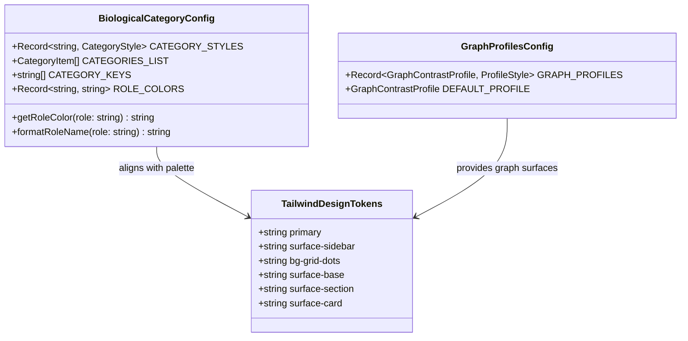

# Data Model: Design System Tokens & Biological Categorization

**Feature**: `006-design-system-tokens-migration`  
**Date**: 2026-11-19  
**Status**: Completed  
**Spec Reference**: [spec.md](./spec.md)

---

## 1. Domain Entities & Configuration Structures

The design system normalization touches configuration entities, design token extensions, and component presentation contracts.



---

## 2. Entity Specifications

### 2.1. Biological Roles & Color Mapping (`src/config/biologicalCategories.ts`)

```typescript
export const ROLE_COLORS: Record<string, string> = {
  ligand: "#0066ff",
  protein: "#ff6b35",
  enzyme: "#10b981",
  receptor: "#f59e0b",
  transcription_factor: "#ec4899",
  tf: "#ec4899",
  adaptor_protein: "#8b5cf6",
  disease: "#06b6d4",
  variant: "#ef4444",
  gene: "#14b8a6",
};

export const DEFAULT_ROLE_COLOR = "#94a3b8";

export function getRoleColor(role?: string): string {
  if (!role) return DEFAULT_ROLE_COLOR;
  const clean = role.toLowerCase().trim().replace(/-/g, "_").replace(/\s+/g, "_");
  return ROLE_COLORS[clean] || DEFAULT_ROLE_COLOR;
}

export function formatRoleName(role?: string): string {
  if (!role) return "Protein";
  const clean = role.toLowerCase().trim().replace(/-/g, "_").replace(/\s+/g, "_");
  switch (clean) {
    case "transcription_factor":
    case "tf":
      return "Transcription Factor";
    case "adaptor_protein":
      return "Adaptor Protein";
    default:
      return clean.charAt(0).toUpperCase() + clean.slice(1);
  }
}
```

### 2.2. Graph Contrast Profiles (`src/config/forceGraphProfiles.ts`)

```typescript
export type GraphContrastProfile = "black" | "white" | "skyblue";

export interface ProfileStyle {
  background: string;
  grid: string;
  nodeBorder: string;
  linkLabel: string;
  textColor: string;
}

export const GRAPH_PROFILES: Record<GraphContrastProfile, ProfileStyle> = {
  black: {
    background: "#111827",
    grid: "#1f2937",
    nodeBorder: "#374151",
    linkLabel: "#9ca3af",
    textColor: "#f3f4f6",
  },
  white: {
    background: "#ffffff",
    grid: "#f3f4f6",
    nodeBorder: "#e5e7eb",
    linkLabel: "#6b7280",
    textColor: "#111827",
  },
  skyblue: {
    background: "#87ceeb",
    grid: "#7ec0db",
    nodeBorder: "#68a6bf",
    linkLabel: "#2c5263",
    textColor: "#0f232c",
  },
};
```

### 2.3. Semantic Tokens Extension (`tailwind.config.ts`)

```typescript
// Extended color and background token entries
export default {
  theme: {
    extend: {
      colors: {
        primary: "#0050cb",
        "surface-sidebar": "#eef3ff",
        // existing surface and material tokens...
      },
      backgroundImage: {
        "grid-dots": "radial-gradient(circle at 2px 2px, #0050cb 1px, transparent 0)",
      },
    },
  },
};
```

---

## 3. Relationships & Data Flow

1. **Pathway Views (`PathwayListView`, `PathwayDetailModal`)**:
   - Ingest `GroupedPathway` domain models.
   - For each entity/role, invoke `getRoleColor(obj.role)` and `formatRoleName(obj.role)` directly from `src/config/biologicalCategories.ts`.
   - Never define internal color maps or duplicate translation functions.

2. **Graph Viewports (`PathwayGraphView`, `ResultsGraph`)**:
   - Read contrast profile options (`black`, `white`, `skyblue`) and their background swatches from `GRAPH_PROFILES[profile].background`.
   - Set viewport canvas background using `GRAPH_PROFILES[currentProfile].background`.

3. **Public Auth Pages (`Register`, `RecoveryPassword`)**:
   - Render the decorative grid background via `className="... bg-grid-dots bg-[size:40px_40px]"`.
   - All brand blue accents use `text-primary`, `bg-primary`, or `border-primary`.

4. **Navigation Sidebar (`Sidebar`)**:
   - Main container renders `bg-surface-sidebar` instead of `bg-[#eef3ff]`.
